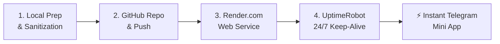

# 🚀 Telegram Mini App & Bot Deployment Runbook

This skill automates the complete 4-stage pipeline for publishing and deploying Telegram Mini Apps (Web Apps) and Bots to **GitHub**, **Render.com** (Free Plan), and keeping them **100% awake 24/7** without slow cold-start screens.

---

## 📋 Pipeline Overview



---

## Stage 1: Local Preparation & Sanitization

Before publishing any code, verify and prepare the following requirements:

### 1.1 Protect Secrets (`.gitignore`)
Ensure no credentials, database files, or user media can ever be leaked:
```gitignore
.env
data/
*.db
*.sqlite3
venv/
__pycache__/
.DS_Store
```
Create a clean `.env.example`:
```env
BOT_TOKEN=your_bot_token_here
ADMIN_TELEGRAM_ID=your_id_here
WEBAPP_URL=https://your-app-name.onrender.com
```

### 1.2 Dynamic Port Support (`PORT` environment variable)
Render, Koyeb, and Heroku inject a dynamic `$PORT` (e.g. 10000). The Python server **must** read it dynamically:
```python
import os
import uvicorn

port = int(os.getenv("PORT", 8080))
config = uvicorn.Config(app, host="0.0.0.0", port=port, log_level="info")
```
*(Ensure `import os` is present to avoid `NameError` at startup!)*

### 1.3 Dependencies (`requirements.txt`) & Start Command (`Procfile`)
- Check that `requirements.txt` is present at the root:
  ```txt
  fastapi>=0.115.0
  uvicorn[standard]>=0.30.0
  aiogram>=3.13.0
  aiosqlite>=0.20.0
  aiohttp>=3.10.0
  python-dotenv>=1.0.1
  python-multipart>=0.0.12
  eval-type-backport>=0.2.0
  ```
- Add a `Procfile`:
  ```procfile
  web: python backend/main.py
  ```

### 1.4 Automatic Telegram Menu Button Setup
In `bot.py`, automatically register the persistent Menu Button on bot startup so users don't have to fiddle with `@BotFather`:
```python
from aiogram.types import MenuButtonWebApp, WebAppInfo

async def setup_bot_menu():
    url = os.getenv("WEBAPP_URL", "https://your-app-name.onrender.com")
    try:
        await bot.set_chat_menu_button(
            menu_button=MenuButtonWebApp(
                text="🎬 Відкрити додаток",
                web_app=WebAppInfo(url=url)
            )
        )
    except Exception as e:
        print(f"Warning: could not set chat menu button: {e}")
```

---

## Stage 2: Push to GitHub

Use `gh` CLI (already authenticated with user's GitHub account):

```bash
# 1. Check git status
git status

# 2. Commit all preparation files
git add .
git commit -m "Prepare project for cloud deployment"

# 3. Create public repository and push in one command
gh repo create <repo-name> --public --source=. --remote=origin --push

# 4. Set description and topics
gh repo edit <owner>/<repo-name> \
  --description "Telegram Mini App & Bot with FastAPI and WebApp UI" \
  --add-topic "telegram-bot,telegram-mini-app,fastapi,aiogram,webapp"
```

---

## Stage 3: Deploy on Render.com (Free Tier)

Delegate browser navigation to the `browser` subagent (or guide the user):

1. **Open Render Dashboard:** `https://dashboard.render.com/select-repo?type=web`
2. **Connect Repository:** Select `<owner>/<repo-name>` and click **Connect**.
3. **Configure Service:**
   - **Name:** `<repo-name>`
   - **Region:** `Frankfurt (EU Central)`
   - **Branch:** `main`
   - **Runtime:** `Python 3`
   - **Build Command:** `pip install -r requirements.txt`
   - **Start Command:** `python backend/main.py`
   - **Plan:** `Free` ($0/mo)
4. **Environment Variables:**
   - `BOT_TOKEN`: `<telegram-bot-token>`
   - `ADMIN_TELEGRAM_ID`: `<telegram-user-id>`
   - `WEBAPP_URL`: `https://<repo-name>.onrender.com`
   - Any API keys (e.g., `TMDB_API_KEY`)
5. **Click "Create Web Service"**.
6. **Watch deployment** until status turns to **`Live 🎉`**.
7. **Verify:**
   ```bash
   curl -s -I https://<repo-name>.onrender.com/
   ```

---

## Stage 4: Eliminate Cold Starts (24/7 Instant Loading)

### Problem:
Render's Free Tier spins down (sleeps) instances after **15 minutes** of inactivity. The first visitor experiences a 30–45 second *"Service waking up"* waiting screen.

### Solution:
Render sleeps after **15 min**, so a lightweight HTTP ping every **5 minutes** keeps the instance permanently awake and hot, consuming no extra cost.

### Automated UptimeRobot Setup:
1. Open `https://dashboard.uptimerobot.com/sign-up/` in the browser.
2. In the **"Website to monitor"** input field, enter:
   `https://<repo-name>.onrender.com/api/movies` (or any fast GET API endpoint like `/api/health`).
3. Click the **"Github"** sign-up button (authenticates in 1 click using the open GitHub session).
4. Authorize UptimeRobot.
5. In the dashboard, verify the monitor is created:
   - **Type:** HTTP/S
   - **Monitoring Interval:** 5 minutes
   - **Status:** Active / Up

---

## ✅ Final Verification Checklist

- [ ] `curl -s -w "%{http_code} (%{time_total}s)\n" https://<repo-name>.onrender.com/` returns `200` in `<0.2s`.
- [ ] Telegram bot responds to `/start` with the welcome animation and inline WebApp button.
- [ ] The persistent bottom Menu Button (`MenuButtonWebApp`) opens the Mini App inside Telegram without warnings.
- [ ] UptimeRobot shows green checkmark for the 5-minute health check.
- [ ] Opening the Mini App from a phone opens instantly with 0 waiting time.
